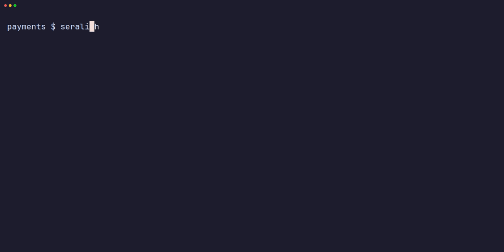

<p align="center">
  
</p>

<h3 align="center">Build in parallel. Ship with proof.</h3>

<p align="center">
  Seralith runs human and agent coding sessions in isolated workspaces and records
  signed, line-level provenance for every change.
</p>

<p align="center">
  <a href="https://seralith.com">seralith.com</a> ·
  <a href="https://x.com/seralithhq">@seralithhq</a>
</p>

<p align="center">
  <a href="LICENSE"></a>
  
</p>

<p align="center">
  
</p>

A workspace on its own worktree, a manual edit, and a session. `seralith commit`
signs a change attestation into `refs/notes/seralith`, and `seralith blame` shows
which lines are human and which are agent. The walkthrough is
[Authorship tracking](docs/features/authorship-tracking.md).

## Why

People and coding agents can work at the same time, each in its own workspace,
with whatever terminal tool the operator chooses. Seralith records which lines
each actor wrote, and which changes a reviewer approved, from snapshots taken
around that work.

Regulators have noticed. The U.S. Department of War's *Accelerated Mission
Software* instruction (DoWI 8430.01, effective September 2026) treats
AI-generated code as unverified input and calls for verifiable build integrity,
provenance, and pedigree. The EU Cyber Resilience Act's reporting obligations
took effect the same month. Secure software attestations under NIST SP 800-218
are already a condition of selling to the federal government.

## How it works

1. **Initialize.** `seralith init` writes `.seralith/config.yaml`,
   `.seralith/policy.yaml`, and `.seralith/trust.yaml`. Your private key stays
   on the machine, at `~/.config/seralith/keys/default.pem` on Linux. The trust
   store receives the public key. `seralith init` grants that key the
   `maintainer` role.
2. **One worktree per task.** `seralith ws new <name>` creates a git worktree
   on branch `seralith/<name>`, outside the repository (by default under
   `~/.local/share/seralith/worktrees`). The primary checkout does not move.
3. **Attribute what changed.** Seralith snapshots the worktree before and after
   each session and attributes the difference to that session's actor. An edit
   made outside a session becomes a manual segment attributed to the workspace
   owner. Seralith launches these tools as-is. It never proxies model traffic
   or handles your credentials. `seralith agents` lists the built-in profiles
   and whether each command is on `PATH`.
4. **Sign the commit.** `seralith commit` commits the worktree and stores an
   [in-toto](https://in-toto.io) attestation in a DSSE envelope, signed with
   Ed25519, on `refs/notes/seralith`. `seralith sync push` publishes that ref.
5. **Check it again in CI.** `seralith gate` verifies the commits in a range.
   It checks signatures, that each segment continues from the previous tree
   through to the commit tree, that every path in the git diff is declared by
   a segment, policy, and independent approvals. It exits 1 when a commit
   fails. `--config-from <rev>` loads policy and trust from that revision, so
   a branch is judged by its base.

Sessions, commits, approvals, and policy decisions are also appended to a
hash-chained ledger on the machine. `seralith serve` listens on
`127.0.0.1:7457` and serves the workbench when the UI is embedded in the
binary.

## Quick start

Install on Linux or macOS. The script verifies the release checksum:

```sh
curl -fsSL https://raw.githubusercontent.com/seralith-hq/seralith/main/scripts/install.sh | sh
```

Or build from a checkout of this repository. `make release-build` compiles the
workbench into the binary. Requirements are listed in
[CONTRIBUTING.md](CONTRIBUTING.md).

```sh
make bootstrap release-build
export PATH="$(pwd)/bin:$PATH"
seralith version
```

In a git repository that has an `origin` remote:

```sh
seralith init
git add .seralith && git commit -m "chore: enable seralith"
git push origin main

seralith ws new retry
seralith run --ws retry -- "$SHELL" -c 'printf "package retry\n\nfunc Attempts() int { return 3 }\n" > retry.go'
seralith status --ws retry
seralith commit --ws retry -m "feat: add retry helper"
seralith sync push
git push -u origin seralith/retry

seralith blame retry.go --rev seralith/retry
seralith gate --range origin/main..seralith/retry --config-from origin/main
```

`seralith blame` reads `HEAD` unless you pass `--rev`. The file above is on
`seralith/retry`, not on the primary checkout, so blame without `--rev` fails
with `no such path retry.go in HEAD`.

`seralith gate --base origin/main` means `origin/main..HEAD`. The primary
checkout is still on your base branch after `seralith ws new`, so that range
is empty, the command prints `no commits in range`, and it exits 0. Pass
`--range origin/main..seralith/retry`. In CI the checkout is the pull request,
and the action below passes `origin/<base>..HEAD`.

`seralith run --agent <id>` launches a profile from `seralith agents`. The
profile's command has to be on `PATH`; a missing command exits with
`executable file not found`. `--model <name>` records the model the operator
declared.

```sh
seralith serve
```

`--open` opens that URL in a browser.

## Gate pull requests

```yaml
- uses: actions/checkout@v7
  with:
    fetch-depth: 0
- uses: seralith-hq/seralith@v0.1.0
```

The action installs `seralith`, fetches the base branch and
`refs/notes/seralith`, and runs:

```sh
seralith gate --range "origin/<base>..HEAD" --config-from "origin/<base>" --format github
```

`<base>` defaults to the pull request base. The full workflow is in
[GitHub Actions](docs/integrations/github-actions.md). Publish attestations
with `seralith sync push` before CI fetches them.

The default policy requires one approval from a key that holds `security` for
changes under `auth/`, `crypto/`, `security/`, `*.tf`, and `Dockerfile`.
`humanLabels` is `unverified`, so a human-labeled edit of those paths needs
the same approval. A shell session that added `internal/auth/token.go` on
`seralith/auth-refactor` triggered rule `security-critical-review`, and the
gate failed with no approval on record.

The approver has to be someone other than the committer. The committer's own
`seralith approve`, even with a key that holds `security`, does not satisfy
the rule. `seralith init` does not grant `security`; approving with
`--role security` on that key prints `your key does not hold the role security`,
and the gate still fails. The reviewer's public key belongs in the base
branch's `.seralith/trust.yaml`, because `--config-from` reads trust from that
revision.

```sh
seralith approve seralith/auth-refactor --role security -m "reviewed"
seralith sync push
```

The default policy denies agent edits to `.github/workflows/**`,
`.gitlab-ci.yml`, `Jenkinsfile`, and `.circleci/**`. A human-labeled edit of
those paths needs one independent approval. A shell session that added
`.github/workflows/ci.yml` triggered `agents-no-pipeline-edits` with that
requirement, and the gate failed with no approval on record.

<p align="center">
  
</p>

`seralith gate` passes a change that triggers no rules, then fails a protected
path that has no approval.

## Architecture

The CLI and the workbench talk to a local daemon. Attestations travel in git.
CI runs the gate. Seralith Control, the commercial control plane, is optional.

```
┌──────────────────────────────────────────────────────────────────────────┐
│ Developer machine                                                        │
│                                                                          │
│ seralith CLI ──┐                   ┌── Workbench UI (React) ──┐          │
│                ▼                   ▼                          │          │
│    ┌──────────────── seralith daemon (Go) ─────────────────┐  │          │
│    │ workspaces · sessions (PTY) · snapshots · policy      │◀─┘          │
│    │ attest (in-toto + DSSE) · ledger (hash chain)         │             │
│    └───────────────────────────┬───────────────────────────┘             │
│                                ▼                                         │
│               git worktrees + refs/notes/seralith                        │
└────────────────────────────────┬─────────────────────────────────────────┘
                                 │ push
                                 ▼
               CI: seralith gate ─────▶ Seralith Control (ee)
                                        trusted keys, policy bundles,
                                        attestation archive,
                                        evidence packages
```

See [Architecture](docs/architecture.md).

## Repository layout

| Path | Contents |
| --- | --- |
| `cmd/seralith` | The `seralith` CLI and daemon entry point |
| `internal/` | Core packages: attestation, ledger, policy, workspaces, sessions, API |
| `pkg/` | Public Go API for integrators |
| `web/` | Workbench UI (React, TypeScript, Vite) |
| `ee/` | Seralith Control, the commercial control plane |
| `site/` | Marketing site |
| `deploy/` | Container images, Compose, and Kubernetes manifests |
| `scripts/` | Installer and maintenance scripts |
| `docs/` | Product, specification, and security documentation |
| `brand/` | Logo assets |

## Editions

| | Community | Team | Enterprise | Sovereign |
| --- | --- | --- | --- | --- |
| Workbench, CLI, local attestations, gates | Yes | Yes | Yes | Yes |
| Hosted control plane, trusted key registry | | Yes | Yes | |
| SSO/SCIM, role-based approvals, retention | | | Yes | Yes |
| Air-gapped, on-premises, FIPS builds | | | | Yes |
| Price | Free | $29 / dev / month | $79 / dev / month | Contact sales |

## Documentation

The guides in [`docs/`](docs/README.md) are published at
[seralith.com/docs](https://seralith.com/docs).

### Features

- [Authorship tracking](docs/features/authorship-tracking.md) — how Seralith observes which lines a person or an agent wrote, and the evidence it records
- [Policy gates](docs/features/policy-gates.md) — how rules allow, warn, require approval, or deny a change, at commit and again in CI

### Guides

- [Getting started](docs/getting-started.md)
- [Architecture](docs/architecture.md)
- [CLI reference](docs/cli.md)
- [GitHub Actions](docs/integrations/github-actions.md) · [GitLab CI](docs/integrations/gitlab-ci.md)
- [Self-hosting Seralith Control](docs/operations/self-hosting.md)

### Specifications

- [Attestation format](docs/spec/attestation.md)
- [Policy language](docs/spec/policy.md)
- [Trust store](docs/spec/trust-store.md)
- [Audit ledger](docs/spec/ledger.md)
- [Evidence packages](docs/spec/evidence.md)

### Security and compliance

- [Threat model](docs/security/threat-model.md)
- [Compliance mapping](docs/compliance/mapping.md)

## Contributing

We welcome contributions. Read [CONTRIBUTING.md](CONTRIBUTING.md) and our
[Code of Conduct](CODE_OF_CONDUCT.md). Report vulnerabilities through
[SECURITY.md](SECURITY.md).

## License

The Seralith workbench, CLI, and libraries are licensed under the
[Apache License 2.0](LICENSE). Code in [`ee/`](ee/) is licensed under the Seralith
Commercial License.

Copyright 2026 Seralith, Inc.
