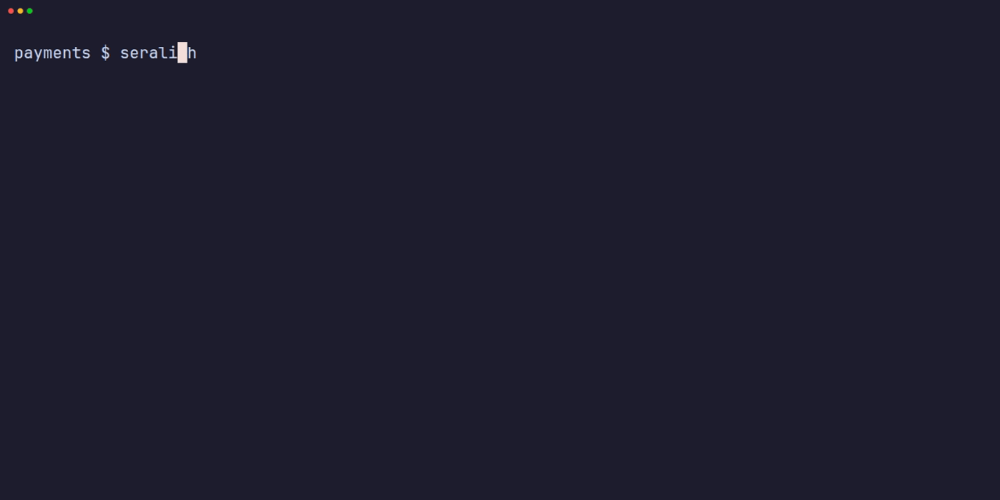

# Authorship tracking

Seralith records which lines a person wrote and which lines a coding agent
wrote by observing the working tree. It snapshots the tree before and after
every session and attributes the difference to that session's actor. Agents are
never asked to describe their own work.

## See it

A workspace on its own worktree, a manual edit, and a session. `seralith commit`
signs a change attestation into `refs/notes/seralith`. The note is read back,
then `seralith blame` shows which lines are human and which are agent.



## How it works

Seralith is not an AI product. It launches your editor, a shell, or any coding
agent CLI as an ordinary process. It never proxies model traffic, holds API
keys, or meters tokens.

### Workspaces

Each task runs in its own workspace: a git worktree on a `seralith/<name>`
branch, stored outside the repository (by default under
`~/.local/share/seralith/worktrees`). Each workspace records:

- `head`: the commit it is based on
- `checkpoint`: the tree hash of the last observed state
- `segments`: observed changes not yet bound to a commit

### Snapshots

A snapshot writes the entire working tree, including untracked files that are
not ignored, to a git tree object. It uses a temporary index seeded from the
real one, so it never disturbs your staging area. Snapshots are
content-addressed, so identical states have identical hashes.

### Sessions and segments

A session runs one command in one workspace under a pseudo-terminal:

1. Observe the workspace. Any change since the checkpoint becomes a **manual
   segment** attributed to the workspace owner.
2. Start the process with `SERALITH_SESSION`, `SERALITH_WORKSPACE`, and
   `SERALITH_ACTOR` in its environment. Stream output to the terminal, any
   number of WebSocket subscribers, and a transcript file.
3. When it exits, snapshot again. The difference becomes a **session
   segment** attributed to the session's actor, with the transcript's SHA-256.

Only one session may run per workspace at a time, so every change has exactly
one author. Parallelism comes from running many workspaces.

### Line attribution

Attribution replays the segments' zero-context diff hunks in order, tracking
which segment owns each line as run-length intervals. Content that predates
tracking is a baseline run, so file contents never need to be read.
`seralith blame` combines this per-commit attribution with `git blame` to
attribute every surviving line in a file across its history.

## Use it

Initialize the repository once and commit the result:

```sh
seralith init
git add .seralith && git commit -m "chore: enable seralith"
```

Create one workspace per task:

```sh
seralith ws new payments-retry
seralith ws new docs-refresh
```

Each `seralith ws new` prints the workspace's branch, the commit it starts
from, and where its worktree lives:

```
✓ workspace payments-retry on seralith/payments-retry from eaa2441fc47f
  ~/.local/share/seralith/worktrees/acme-b9c89b20/payments-retry
```

Run a coding agent, or your own shell, in a workspace as an attributed session:

```sh
seralith run --ws payments-retry --agent codex
seralith run --ws docs-refresh --agent gemini --model pro
seralith run --ws payments-retry -- $SHELL
```

Seralith prints one line when the tool starts and one when it exits. In
between, the tool runs in your terminal as it normally does:

```
◆ seralith codex in payments-retry as agent:codex(codex)
◆ seralith session ses_5be5a31a exited 0 · 1 file changed (+15 −0)
```

`seralith agents` lists the supported coding tools and whether they are
installed.

Edits you make yourself, in any editor, inside the workspace directory are
attributed to you:

```sh
cd "$(seralith ws path payments-retry)"
$EDITOR internal/payments/retry.go
```

Review pending segments, attribution, and policy before you commit:

```sh
seralith status --ws payments-retry
```

```
workspace payments-retry  seralith/payments-retry

SEGMENT       KIND     ACTOR                  FILES   LINES
ses_5be5a31a  session  agent:codex            1 file  +15 −0
seg_8957f38c  manual   human:you@example.com  1 file  +1 −1

attribution agent 14 (93%) · human 1 (6%)
policy no rules triggered
```

When a policy rule applies, the `policy` line lists it instead, for example
`require-approval   security-critical-review (1 approval from security)`.

Commit with a signed attestation and publish it:

```sh
seralith commit --ws payments-retry -m "feat(payments): retry failed captures"
seralith sync push
```

```
✓ 9d1fd4007593 feat(payments): retry failed captures
  attestation  6403e7a4a4d4825df9320be93a4ca98007a4e8f99909ef7dc37112b3a553c00d
  segments     2
  attribution  agent 14 (93%) · human 1 (6%)
policy no rules triggered
```

Ask who wrote each line of a file. Each line shows the commit, who wrote it (the
agent profile for agent lines, the person for human lines), the line number,
and the text:

```sh
seralith blame internal/payments/retry.go
```

```
9d1fd400 codex                       1 │ package payments
9d1fd400 codex                       2 │
9d1fd400 codex                       3 │ import "time"
9d1fd400 codex                       4 │
9d1fd400 codex                       5 │ // Retry calls fn until it succeeds or attempts run out.
9d1fd400 codex                       6 │ func Retry(attempts int, delay time.Duration, fn func() error) error {
9d1fd400 codex                       7 │ 	var err error
9d1fd400 codex                       8 │ 	for i := 0; i < attempts; i++ {
9d1fd400 codex                       9 │ 		if err = fn(); err == nil {
9d1fd400 codex                      10 │ 			return nil
9d1fd400 codex                      11 │ 		}
9d1fd400 you@example.com            12 │ 		time.Sleep(delay * time.Duration(i+1))
9d1fd400 codex                      13 │ 	}
9d1fd400 codex                      14 │ 	return err
9d1fd400 codex                      15 │ }

15 lines · human 1 (6%) · agent 14 (93%)
```

Add `--summary` for the last line alone, and `--rev <revision>` to blame a
branch or commit other than `HEAD`:

```sh
seralith blame internal/payments/retry.go --summary
# 15 lines · human 1 (6%) · agent 14 (93%)
```

Every command accepts `--json` for machine-readable output. See the
[CLI reference](../cli.md) for all flags.

## Evidence it produces

| Evidence | Where it lives | What it records |
| --- | --- | --- |
| Segments in the `change/v1` attestation | `refs/notes/seralith`, pushed with `seralith sync push` | Kind (`session` or `manual`), actor, command, start and end times, snapshot trees before and after, exit code, transcript SHA-256, and per-file hunks |
| Line attribution | The same attestation | Line ranges in the commit tree owned by each segment, and surviving lines per actor kind |
| Actor | Each segment | Kind (`human` or `agent`), principal or agent profile ID, tool and version, declared model, the accountable operator, and host |
| Transcripts | `<git-common-dir>/seralith/`, local | The terminal output of each session; the attestation carries its digest |
| Ledger entries | `<git-common-dir>/seralith/`, local | Every workspace, session, commit, and approval, in a hash-chained log |
| Evidence package | `seralith evidence export` | `attestations/*.jsonl` and `ai-usage.json` (tools, versions, declared models, operators), among other files |

The attestation is signed by the human committer. The CI gate re-checks that
the segments chain from the parent tree to the commit tree, so a commit cannot
contain changes that were not observed. See the
[attestation specification](../spec/attestation.md).

## Limits

- **Declared actors.** Which actor made each segment is recorded by the
  committer's own Seralith, so a holder of a trusted key can label agent work
  as human. With the default `humanLabels: unverified`, agent rules that
  protect paths also apply to human-labeled changes to those paths, so a
  protected change still needs an independent approval. See the
  [policy specification](../spec/policy.md).
- **Concurrent edits.** Changes made in the same worktree while a session runs
  are attributed to the session's actor. Use a separate workspace to work in
  parallel.
- **Declared models.** The model field records what the operator declared.
  Seralith does not see model traffic and cannot verify it.

The [threat model](../security/threat-model.md) lists every known limitation.

## Related

- [Getting started](../getting-started.md)
- [Architecture](../architecture.md)
- [Attestation format](../spec/attestation.md)
- [Policy language](../spec/policy.md)
- [Compliance mapping](../compliance/mapping.md): how this evidence maps to
  DoWI 8430.01, NIST SP 800-218, NIST SP 800-171, and the EU CRA
